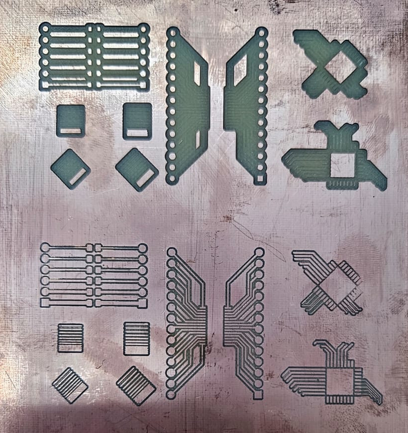

# Configuração do Projeto e Regras de Design (KiCad)

Para evitar quebras de ferramentas finas, curtos por sobreposição de cobre ou falhas no isolamento durante o fresamento mecânico, o projeto no KiCad deve obrigatoriamente respeitar as restrições abaixo (`File > Board Setup > Design Rules > Constraints`).

---

## Metodologia

Para obtenção das regras de design foi projetada uma placa de testes, o projeto completo, bem como gerbers, gcode, e projeto do FlatCAM podem ser obtidos no [repositório deste tutorial](https://github.com/felipebarino/guia-ttp-gcom/ssets\Construção_DesignRules).

O resultado encontrado para profundidade de corte igual a 0.05 mm e 0.035 mm pode ser visto abaixo.

   
    
   <em>Resultado de Construcao Design Rules</em>

Inspecionando as espessuras de trilhas e a isolação correta na placa resultantes e no projeto, chegou-se às regras de design listadas abaixo. 

_*Note que há alguns trechos em que a placa não foi corretamente usinada, alterando-se a profundiade de corte para 0.037 mm corrigiu o problema com as mesmas regras de projeto._ 

## Tabela de Restrições (DRC)

| Categoria | Parâmetro | Valor Mínimo Recomendado | Função no Processo Mecânico |
| :--- | :--- | :--- | :--- |
| **Copper** | Minimum clearance | `0,20 mm` | Evita curtos entre trilhas vizinhas |
| | Minimum track width | `0,20 mm` | Garante integridade física das trilhas usinadas |
| | Minimum connection width | `0,25 mm` | Garante junção segura em ilhas de solda |
| | Minimum annular width | `0,3 mm` | Evita rompimento do anel de solda na furação |
| | Minimum via diameter | `0,80 mm` | Facilita a passagem de pinos/fios de interconexão |
| | Copper to hole clearance | `0,25 mm` | Mantém o isolamento entre broca e cobre energizado |
| | **Copper to edge clearance** | **`0,50 mm`** | Previne que a fresa de contorno atinja trilhas |
| **Holes** | Minimum through hole | `0,30 mm` | Diâmetro mínimo usinável pelas brocas de precisão |
| | Hole to hole clearance | `0,90 mm` | Previne fratura do FR4/fenolite entre furos próximos |
| **uVias** | Minimum uVia diameter | `0,50 mm` | Parâmetro para micro-vias |
| | Minimum uVia hole | `0,30 mm` | Parâmetro para furação de micro-vias |

---

## Exportação de Arquivos Gerber e Furação

### Gerber Plot (`File > Fabrication Outputs > Gerbers (.gbr)`)
1. Defina o diretório de saída (ex: `out/v1/`).
2. Marque as camadas obrigatórias:
   * `F.Cu` (Cobre Superior)
   * `B.Cu` (Cobre Inferior)
   * `Edge.Cuts` (Contorno da Placa)
3. Em **General Options**, mantenha selecionado:
   * [x] *Plot footprint values*
   * [x] *Plot reference designators*
   * [x] *Plot footprint text*
   * [x] *Check zone fills before plotting*
   * [x] *Tent vias*
4. **Formato de coordenadas:** `4.6, unit mm`.
5. Clique em **Plot**.

### Furação Excellon (`Generate Drill Files...`)
1. Ajuste os parâmetros da janela:
   * **Drill File Format:** `Excellon` com `PTH and NPTH in single file` marcado.
   * **Oval Holes Drill Mode:** `Use route command (recommended)`.
   * **Map File Format:** `Gerber X2`.
   * **Drill Origin:** `Absolute`.
   * **Zeros Format:** `Decimal format (recommended)`.
2. Clique em **Generate Drill File**.