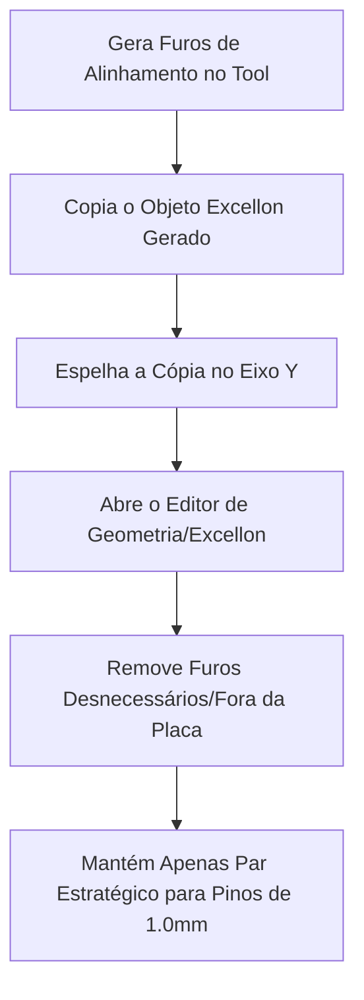
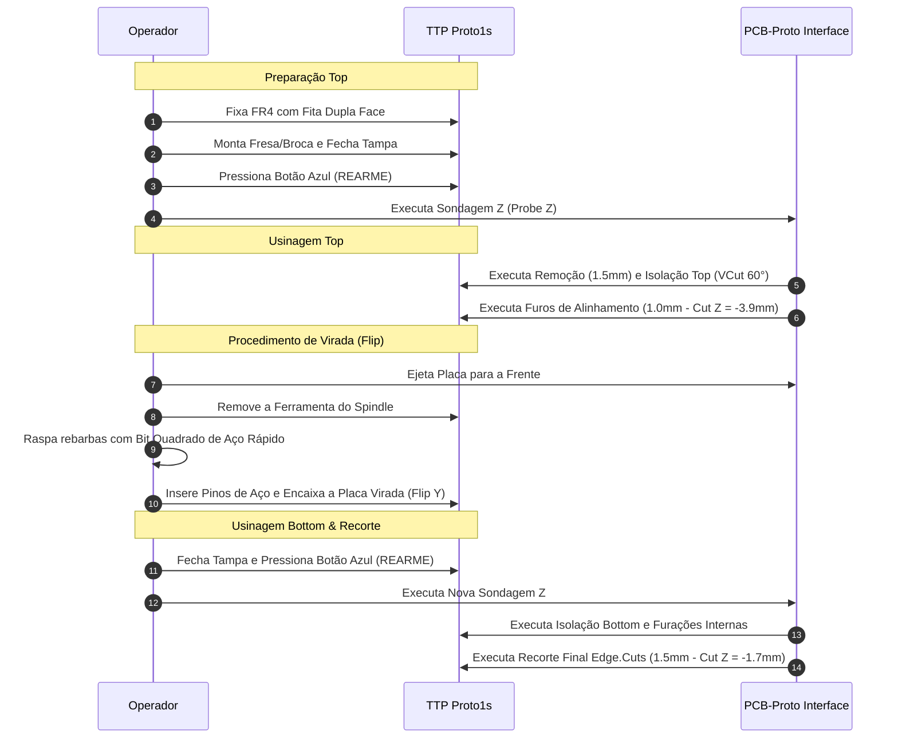

# Manual de Operação Local — TTP Proto1s

!!! warning "Aviso de Referência e Complementaridade"
    Este documento é um guia prático interno do laboratório e destina-se a padronizar o fluxo de trabalho e registrar as regras de projeto da nossa bancada. **Este material complementa e NÃO substitui o manual/tutorial oficial** fornecido pela TTP Indústria Mecânica Ltda. Ele pode ser acessado em [Tutorial TTP](https://www.ttp.ind.br/portal/tutorial/index.html).

---

## 1. Configuração do Projeto e Regras de Design (KiCad)

Para evitar quebras de ferramentas finas, curtos por sobreposição de cobre ou falhas no isolamento durante o fresamento mecânico, o projeto no KiCad deve obrigatoriamente respeitar as restrições abaixo (`File > Board Setup > Design Rules > Constraints`):

### 1.1 Tabela de Restrições (DRC)

| Categoria | Parâmetro | Valor Mínimo Recomendado | Função no Processo Mecânico |
| :--- | :--- | :--- | :--- |
| **Copper** | Minimum clearance | `0,20 mm` | Evita curtos entre trilhas vizinhas |
| | Minimum track width | `0,20 mm` | Garante integridade física das trilhas usinadas |
| | Minimum connection width | `0,25 mm` | Garante junção segura em ilhas de solda |
| | Minimum annular width | `0,23 mm` | Evita rompimento do anel de solda na furação |
| | Minimum via diameter | `0,80 mm` | Facilita a passagem de pinos/fios de interconexão |
| | Copper to hole clearance | `0,25 mm` | Mantém o isolamento entre broca e cobre energizado |
| | **Copper to edge clearance** | **`0,50 mm`** | Previne que a fresa de contorno atinja trilhas |
| **Holes** | Minimum through hole | `0,30 mm` | Diâmetro mínimo usinável pelas brocas de precisão |
| | Hole to hole clearance | `0,90 mm` | Previne fratura do FR4/fenolite entre furos próximos |
| **uVias** | Minimum uVia diameter | `0,50 mm` | Parâmetro para micro-vias |
| | Minimum uVia hole | `0,30 mm` | Parâmetro para furação de micro-vias |
| **Silkscreen**| Minimum text height / thickness | `0,80 mm` / `0,08 mm` | Referência de legibilidade |

---

### 1.2 Exportação de Arquivos Gerber e Furação

#### Gerber Plot (`File > Fabrication Outputs > Gerbers (.gbr)`)
1. Defina o diretório de saída (ex: `out/v1/`).
2. Marque as camadas obrigatórias:
   * `F.Cu` (Cobre Superior)
   * `B.Cu` (Cobre Inferior)
   * `Edge.Cuts` (Contorno da Placa)
3. Em **General Options**, mantenha selecionado:
   * [x] *Plot footprint values*
   * [x] *Plot reference designators*
   * [x] *Plot footprint text*
   * [x] *Check zone fills before plotting*
   * [x] *Tent vias*
4. **Formato de coordenadas:** `4.6, unit mm`.
5. Clique em **Plot**.

#### Furação Excellon (`Generate Drill Files...`)
1. Ajuste os parâmetros da janela:
   * **Drill File Format:** `Excellon` com `PTH and NPTH in single file` marcado.
   * **Oval Holes Drill Mode:** `Use route command (recommended)`.
   * **Map File Format:** `Gerber X2`.
   * **Drill Origin:** `Absolute`.
   * **Zeros Format:** `Decimal format (recommended)`.
2. Clique em **Generate Drill File**.

---

## 2. Tabela de Ferramentas do Laboratório

Todas as ferramentas utilizadas no Spindle da TTP Proto1s **devem ter haste de exatamente 1/8” ($3,175\text{ mm}$)**. Ferramentas fora dessa especificação danificam a pinça de aperto.

### 2.1 Identificação por Anel Colorido

| Tipo | Cor do Anel de Nylon | Diâmetro Configurado | Aplicação Principal |
| :--- | :--- | :--- | :--- |
| **Fresa** | **V 60° (VCut)** | **`0,199 mm`** | Isolação de trilhas e pads SMD/PTH (profundidade $Z = 0,037\text{ mm}$) |
| **Fresa** | **Vinho** | `1,50 mm` | Remoção de grandes áreas de cobre |
| **Fresa** | **Laranja Escuro** | `1,50 mm` | Desbaste / Recorte final do contorno (`Edge.Cuts`) |
| **Broca** | **Verde Água** | `0,30 mm` | Vias e furos extra finos |
| **Broca** | **Azul** | `0,30 mm` | Vias e furos extra finos |
| **Broca** | **Amarelo** | `0,40 mm` | Vias SMD / Furos pequenos |
| **Broca** | **Marrom** | `0,60 mm` | Furos padronizados / Vias de pino |
| **Broca** | **Branco** | `0,60 mm` | Furos padronizados / Vias de pino |
| **Broca** | **Laranja Claro** | `0,80 mm` | Terminais Through-Hole |
| **Broca** | **Verde Escuro** | `1,00 mm` | Pinos de alinhamento duplo-lado e conectores |
| **Broca** | **Verde Claro** | `1,00 mm` | Pinos de alinhamento duplo-lado e conectores |
| **Broca** | **Roxo** | `1,30 mm` | Terminais largos e conectores de potência |

!!! info "Detalhamento da Geometria da Fresa VCut 60°"
    A fresa cônica V 60° altera sua largura efetiva de usinagem conforme afunda na placa. Para remover a camada padrão de $35\,\mu\text{m}$ de cobre com tolerância, a profundidade do eixo Z é travada em **$0,037\text{ mm}$**. Nessa profundidade específica, o diâmetro de corte resultante no CAM deve ser configurado como **$0,199\text{ mm}$**.

---

## 3. Regras Práticas do Laboratório e Segurança

### 3.1 Margem do Substrato e Fixação
* **Tamanho Utilizável:** O tamanho detectado pelos sensores da máquina durante o mapeamento automático é menor que o tamanho físico real da placa de FR4 virgem.
* **Corte do Substrato:** Deixe sempre uma sobra de **$5\text{ mm}$ a $10\text{ mm}$ em cada lado** em relação ao contorno do `Edge.Cuts`.
* **Fixação:** Aplique fita dupla face cobrindo uniformemente o verso do substrato para impedir vibrações, evitando cobrir as áreas onde a broca atravessará totalmente a placa.

### 3.2 Segurança e Rearme Obrigatório
!!! danger "Parada de Segurança e Trava de Operação"
    Ao abrir a tampa de proteção acrílica da TTP Proto1s, o spindle é desligado e o movimento de todos os eixos é interrompido imediatamente.

    **Procedimento de Rearme:** Sempre que abrir e fechar a tampa (para trocar ferramentas, aspirar resíduos ou virar a placa), é **obrigatório pressionar o botão azul de REARME** localizado no painel frontal da máquina. Caso contrário, os comandos do software serão ignorados.

---

## 4. Preparação no CAM (FlatCAM / PCB-Proto Studio)

### 4.1 Configurações Iniciais
1. Importe os arquivos Gerber e Excellon.
2. Certifique-se de que a unidade global do software está em **milímetros (mm)**.

### 4.2 Espelhamento da Camada Inferior (Flip Y)
* Selecione o objeto Gerber correspondente à camada inferior (`B.Cu`).
* Aplique a função **Mirror** utilizando o **Eixo Y** como referência de espelhamento.

---

### 4.3 Furos de Alinhamento (Procedimento de Correção / Workaround)

!!! bug "Defeito Identificado na Geração Automática"
    A função de geração automática de furos de alinhamento da versão atual do software apresenta falhas, criando furos incorretos ou em posições indesejadas fora da placa. Siga o procedimento manual abaixo.

#### Parâmetros de Furação para Alinhamento:
* **Ferramenta:** Broca de `1,0 mm` (anel Verde Escuro ou Verde Claro).
* **Cut Z (Profundidade):** **`-3,9 mm`**  
  *(⚠️ **NUNCA utilize `-4,0 mm`**, pois essa profundidade causa quebra da broca ao colidir com o fundo de metal da mesa).*
* **Travel Z (Altura de deslocamento):** `2,0 mm`.
* **Feedrate (Avanço):** `400 mm/min`.

---

### 4.4 Estratégia de Isolação e Remoção de Grandes Áreas

#### Múltiplas Passagens de Isolação (Acesso a Espaços Apertados)
* **Configuração:** Defina entre **2 e 4 passagens (Passes)** na ferramenta de isolação com a VCut 60°.
* **Sobreposição (Overlap):** Configure entre **55% e 70%** (ex: `60%`).
* **Opção:** Marque a caixa **Combine Passes**.

!!! tip "Por que fazer múltiplas passagens com a VCut?"
    A fresa de remoção de grandes áreas (1,5 mm) possui diâmetro grande e não consegue entrar em cantos vivos ou vãos estreitos entre trilhas. Ao fazer 2 a 4 passagens de isolação prévias com a cônica VCut (0,199 mm), você abre um canal mais largo ao redor do circuito, permitindo que a fresa de 1,5 mm navegue livremente sem colidir ou deixar ilhas isoladas de cobre.

#### Remoção de Grandes Áreas (Desbaste)
1. Selecione as geometrias de isolação e execute o **Join** para criar o objeto **Combo**.
2. Selecione a **Fresa 1,5 mm** (Vinho ou Laranja Escuro).
3. **Inspeção Visual Obrigatória:**
   * Após gerar o CNC Job da remoção de áreas, **examine o caminho da ferramenta na tela do CAM**.
   * Se identificar ilhas de cobre remanescentes onde a fresa de 1,5 mm não coube, retorne à etapa de isolação, **aumente o número de passagens da VCut** e refaça o Combo.

---

## 5. Sequência Operacional de Usinagem

### 5.1 Parâmetros de Usinagem Final e Recorte

* **Recorte de Contorno (`Edge.Cuts`):**
  * **Ferramenta:** Fresa Laranja Escuro (`1,5 mm`).
  * **Cut Z:** `-1,7 mm` *(atravessa os $1,6\text{ mm}$ do substrato).*
  * **Travel Z:** `1,0 mm`.
  * **Feedrate:** `750 mm/min`.

### 5.2 Check-list Pós-Usinagem
1. [ ] Ejetar a placa e remover a ferramenta do spindle.
2. [ ] Limpar a placa com palha de aço / álcool isopropílico para remover óxidos.
3. [ ] Testar a continuidade elétrica das trilhas e ausência de curtos com o multímetro.
4. [ ] Aplicar solda/ilhós nas vias de passagem entre as camadas Top e Bottom.